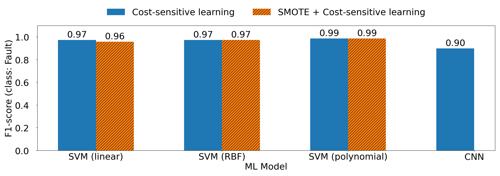
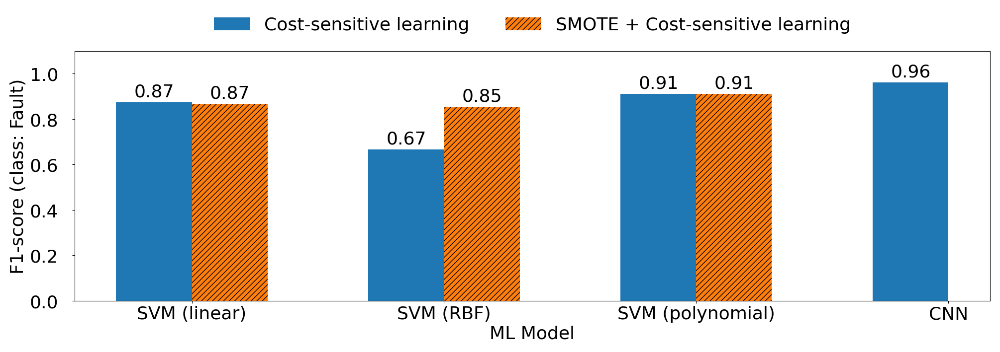
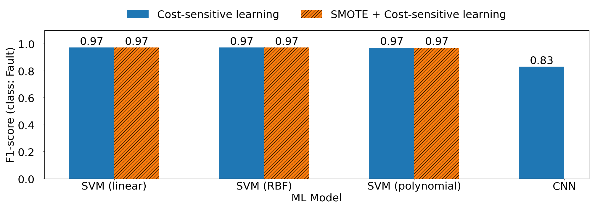
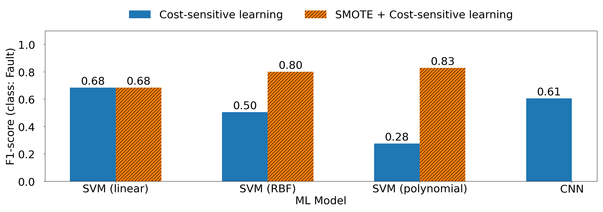

# VacFault
This is the implementation of the paper **Towards data-driven predictive maintenance for vacuum ion pumps at European XFEL** (http://doi.org/10.1107/S1600577526009197).

This project investigates the application of machine learning techniques namely Support Vector Machines (SVM) and Convolutional Neural Networks (CNN) to develop an early fault detection system for vacuum ion pumps installed at European XFEL facility.

## Description
Focus of this work is Sputter Ion Pumps (SIPs) that maintain an ultra-high vacuum environment (~1 × 10<sup>-9</sup> mbar) within the photon beamlines. When the internal components of an ion pump become saturated with noble gases, the pump begins to release these gases back into the vacuum chamber causing peaks in pressure level. This phenomenon is known as Noble Gas Instability (NGI). These peaks can be problematic if pressure exceeds 5 × 10<sup>-6</sup> mbar, triggering the vacuum interlock and causing interruptions in ongoing experiments. Therefore, it is really important to timely detect this effect. However it is difficult to manually monitor pressure data from all (~300) pumps. Moreover, peaks in pressure can also arise from routine adjustments of operational settings, making it difficult to discriminate NGI-related peaks. We analyze the time series pressure data to automatically detect and classify peaks caused due to NGI effect. 

We gather hostorical data from multiple pums and train/evaluate ML modes using SVM and CNN for the classification task. For SVM, statistical features are computed to train the model, while for CNN time series data is sent directly to the input layers of the CNN. To handle the severe data imbalance, two techniques have been implemented: cost-sensitive learning and Synthetic Minority Oversampling Technique (SMOTE). Performance of different ML models is compared using precision, recall and F1-score of *Fault* class. 

## Usage
### Setting up the environment
Clone the repository, create new environment and install the necessary packages

```
git clone https://github.com/aaminahmajid/VacFault.git
cd vacfault
python -m venv env
source env/bin/activate
pip install -r requirements.txt
```

## Datasets
Datasets are stored in 'data/*' folder in forms of pandas data frames. Each rows represents a single data instance, which corresponds to a 15-minute segment of pressure measurements, stored as an array in ‘Data’ column. Statistical fearures are already computed and stored in the following columns: ['std', 'skewness', 'kurtosis', 'hyperskewness'].                                                     
### Machine learnig experiments
To execute ML experiments, run the following script:
```
cd vacfault
source env/bin/activate
python main.py
```
This script will perform following:
- Load the dataset
- Train SVM models (a: using different kernels: linear, RBF, poly and b: using different imbalance techniques: cost-sensitive learning, SMOTE plus cost-sensitive learning )
- Evaluate the performance of SVM models
- Train CNN models
- Evaluate the performance of CNN models
- Save results

### Results
- Results are stored in follwoing folder: 'results/' 
- Figures and tables are stored in following folder: 'reports/'

##### Performance evaluation: F1-score of *Fault* class (DS-I)


##### Performance evaluation: F1-score of *Fault* class (DS-I1)


##### Performance evaluation: F1-score of *Fault* class (DS-III)


<!-- 
##### "Performance evaluation: F1-score of *Fault* class (deployment data)"

 -->


